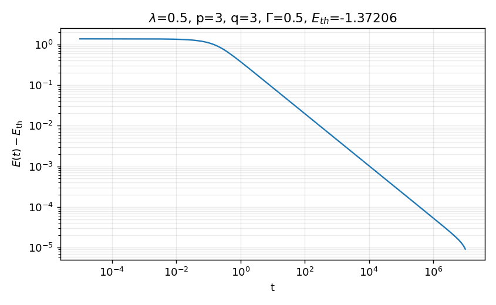
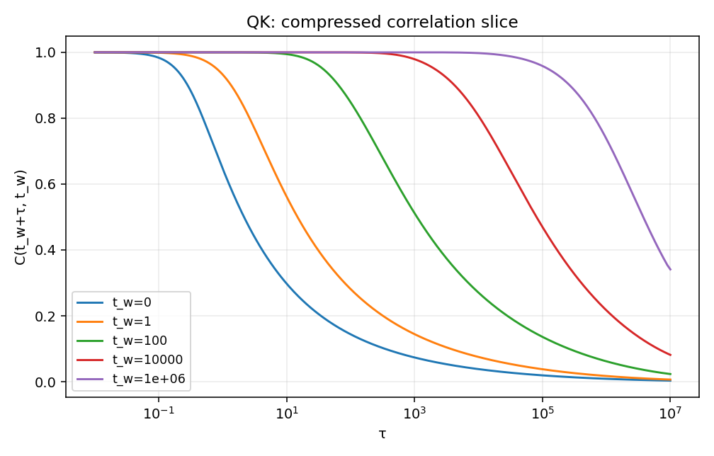

#  Tutorial: Reading outputs

Each run writes into its own directory (see [Usage](../usage.md#output)). This page shows how to look at the results; the complete list of files and their formats is in [Code structure and file formats](../concepts/architecture.md).

## What a run directory contains

| File | Content |
|---|---|
| `correlation.txt` | one line per time step: $t$, energy $E(t)$, $C(t,0)$ |
| `params.txt` | all parameters, program version, grid, run time |
| `data.h5` or `data.bin` | checkpoint with the full history, used to continue the run |
| `QK_compressed`, `QR_compressed`, `t1_compressed.txt` | $C$ and $R$ at the last checkpoint on an $L\times L$ grid |
| `energy.txt`, `rvec.txt`, `qk0.txt` | $E(t)$, $\mu(t)$, $C(t,0)$ at the stored times |
| `step_metrics.txt` | run time and memory per step (with `-D true`) |

All files except `correlation.txt` are written at checkpoints, i.e. every `--sparsify-interval` steps and at the end of the run.

## Energy and $C(t,0)$

`correlation.txt` is the simplest starting point. After a step is rejected, the last ten steps are repeated (see [Time integration](../concepts/time-integration.md)), and the file then contains the discarded steps as well: the time in the first column jumps back. Remove them before plotting, e.g. in Python:

```python
import numpy as np
import matplotlib.pyplot as plt

t, E, C0 = np.loadtxt("Results/<run>/correlation.txt", unpack=True)

# keep only lines whose time is smaller than that of every later line
later_min = np.minimum.accumulate(t[::-1])[::-1]
keep = np.append(t[:-1] < later_min[1:], True)
t, E, C0 = t[keep], E[keep], C0[keep]

plt.loglog(t, C0)
plt.xlabel("t"); plt.ylabel("C(t,0)")
plt.show()
```

For the approach of the energy to the threshold energy $E_{\rm th}$ (quench to $T=0$), the script `scripts/plot_energy_threshold_gap.py` reads the energy and the parameters of a run directory and plots $E(t)-E_{\rm th}$ on logarithmic axes. It uses `energy.txt` if present and `correlation.txt` otherwise:

```bash
python3 scripts/plot_energy_threshold_gap.py Results/<run>/ --skip-nonpositive --out energy.png
```

`--skip-nonpositive` drops the early times at which $E(t)-E_{\rm th}\le0$. The script needs `numpy` and `matplotlib`.



## Two-time functions

The compressed snapshot contains $C(t_i,\theta_j t_i)$ and $R(t_i,\theta_j t_i)$ for $t_i=\theta_i\,t_{\rm last}$, where $t_{\rm last}$ is the time of the last checkpoint. From it, `scripts/plot_correlation.py` plots $C(t_w+\tau,t_w)$ as a function of $\tau$ for several waiting times $t_w$:

```bash
python3 scripts/plot_correlation.py Results/<run>/ --out Cwaiting.png
python3 scripts/plot_correlation.py Results/<run>/ --which QR --out Rwaiting.png   # response
python3 scripts/plot_correlation.py Results/<run>/ --tw "1,10,100,1000"            # chosen waiting times
```

Further options: `--tau-min`, `--tau-max` and `--n-tau` for the range of $\tau$, `--linear-x` for a linear axis, `--usetex` for LaTeX labels. Curves stop at $t_w+\tau=t_{\rm last}$. The script interpolates with SciPy, which it needs in addition to `numpy` and `matplotlib`.



## The full history

The checkpoint contains $C$ and $R$ at all stored times. With HDF5:

```bash
h5ls Results/<run>/data.h5
```

lists the datasets `QKv`, `QRv`, `dQKv`, `dQRv`, `t1grid`, `rvec`, `drvec`. In Python (with `h5py`), `QKv` reshaped to `(len(t1grid), L)` gives $C(t_n,\theta_i t_n)$, with the $\theta_i$ from `Grid_data/<L>/theta.dat`. `scripts/ImportDMFE.wl` reads the file into Mathematica.

## Checking results

Before relying on a result:

- **Tolerance:** repeat the run with `-e` ten times smaller. The observables you use should not change appreciably.
- **Grid:** repeat with $L=1024$ (see [Generate grids](generate-grids.md)).
- **Sparsification:** repeat (the first part of) the run with `-w 0`.
- **Long runs:** make sure the grid was generated with $t_{\max}$ at least equal to the final time; `params.txt` lists it as `grid_Tmax`.
- **Known limits:** for the pure $p$-spin model the exact results listed in [Equations](../concepts/eoms-and-observables.md#useful-exact-results) are a quick check.

`params.txt` records what a run did: the command line, all parameters, the program version and Git commit, and the grid. Keep it together with the results.
